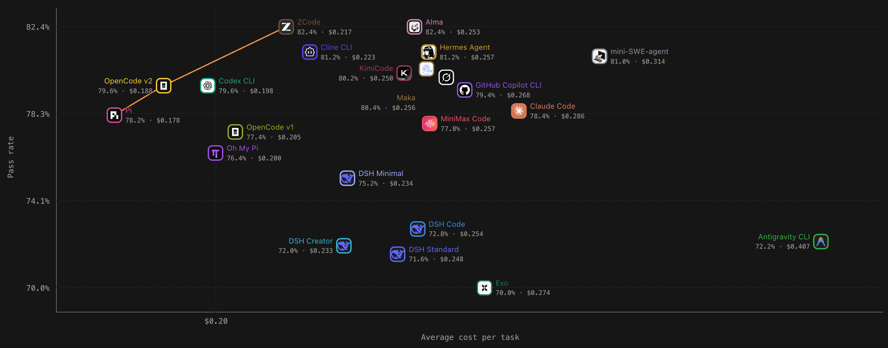

<h1 align="center">FrontierHarness Arena</h1>

<p align="center">
  <a href="https://arena.frontierharness.org/"></a>
  <a href="https://hub.harborframework.com/datasets/frontier-harness-eval/frontier-harness-eval-lite"></a>
  
  
  
  
</p>

<p align="center">
  <a href="https://arena.frontierharness.org/"><strong>Explore the live results →</strong></a>
  &nbsp;·&nbsp;
  <a href="#evaluate-your-own-harness"><strong>Evaluate your own harness →</strong></a>
</p>

FrontierHarness Arena compares AI coding agent harnesses on 25 command-line tasks from FrontierHarness Eval v1.1. Select a model to see how often each harness passes, how much a pass costs, and how long it takes. [Full benchmark](https://github.com/frontier-harness-eval/eval)

<a href="https://arena.frontierharness.org/"></a>

Each logo marks one harness configuration. The orange line connects Pi, OpenCode v2, and ZCode, showing how the highest observed pass rate rises with the average cost per task.

## Full results

Each configuration ran 500 scored attempts across five models. The table starts with the lowest estimated cost per pass. ZCode and Alma tied for the highest pass rate at 82.4%. Select a harness on the leaderboard to inspect its task results. [Interactive leaderboard](https://arena.frontierharness.org/)

| Harness | Cost per pass | Pass rate | Cache hit rate | Time per pass | Version |
| --- | ---: | ---: | ---: | ---: | --- |
| Pi | **$0.227** | 78.2% | 89.0% | 22m 24s | `1.4.0` |
| OpenCode v2 | $0.236 | 79.6% | 90.5% | 26m 50s | `2.2.7` |
| Codex CLI | $0.249 | 79.6% | 88.4% | 25m 12s | `0.164.0` |
| Oh My Pi | $0.262 | 76.4% | 85.7% | 24m 41s | `18.12.6` |
| ZCode | $0.264 | **82.4%** | 86.2% | 20m 05s | `0.17.0` |
| OpenCode v1 | $0.265 | 77.4% | 89.0% | 22m 46s | `1.19.4` |
| Cline CLI | $0.275 | 81.2% | 87.2% | 20m 53s | `3.0.73` |
| Alma | $0.307 | **82.4%** | 86.9% | 20m 12s | `0.4.212` |
| DSH Minimal | $0.311 | 75.2% | 90.3% | 25m 35s | `0.2.1-rc.3` |
| KimiCode | $0.311 | 80.2% | 88.8% | **19m 30s** | `2.3.1` |
| Hermes Agent | $0.316 | 81.2% | 87.8% | 23m 21s | `0.22.5` |
| Maka | $0.319 | 80.4% | 85.5% | 21m 56s | `0.2.2-dev.92.20261019` |
| DSH Creator | $0.323 | 72.0% | 91.8% | 28m 01s | `0.2.1-rc.3` |
| Grok Build | $0.328 | 80.0% | 87.7% | 23m 06s | `1.0.67` |
| MiniMax Code | $0.331 | 77.8% | 88.9% | 21m 54s | `0.6.13` |
| GitHub Copilot CLI | $0.337 | 79.4% | 85.7% | 22m 15s | `1.0.103` |
| DSH Standard | $0.346 | 71.6% | 90.9% | 27m 34s | `0.2.1-rc.3` |
| DSH Code | $0.348 | 72.8% | 89.9% | 28m 09s | `0.2.1-rc.3` |
| Claude Code | $0.364 | 78.4% | 89.2% | 24m 50s | `2.1.308` |
| mini-SWE-agent | $0.387 | 81.0% | 90.6% | 22m 18s | `2.4.6` |
| Exo | $0.392 | 70.0% | 84.8% | 27m 20s | `825318306c0e` |
| Antigravity CLI | $0.564 | 72.2% | **93.7%** | 27m 37s | `1.4.6` |

## Evaluate your own harness

1. Create an evaluation in [Runta Evaluations](https://dashboard.runta.com/evaluations/new). Select the public Harbor dataset `frontier-harness-eval/frontier-harness-eval-lite`, then choose your model provider and model.
2. Select **Custom external agent (Python)** and paste a script that exports your harness as `CustomAgent`. The Arena participation guide includes a working example and a prompt for adapting your own harness. [Participation guide](https://arena.frontierharness.org/participate/)
3. Choose **Smoke evaluation** to test one task. Once it passes, choose **Start evaluation** to run the dataset.
4. When the run finishes, select **Enable public link** under **Public Dashboard link**. Include that link, the harness name and version, and the model in your submission.

### Submissions

To submit by pull request, copy the template to `submissions/<harness>-<version>-<model>.md`, fill it in, and open a PR with one file per run. You can also submit the same details in a GitHub issue. [Submission guide](submissions/) · [File template](submissions/_template.md) · [Open a submission issue](https://github.com/frontier-harness-eval/arena/issues/new?template=harness-submission.yml)

## Methodology

- **Dataset.** Lite v1.0.0 selects 25 tasks from the full benchmark. The published results use the corresponding trials from the v1.1 run. [Harbor dataset](https://hub.harborframework.com/datasets/frontier-harness-eval/frontier-harness-eval-lite)
- **Models.** GLM-5.3, GLM-5.3-Flash, DeepSeek-V4.1-Flash-1017, Muse Spark Open, and Kimi-K3 ran at maximum effort.
- **Trials.** Each harness made four attempts per task and model. Across 25 tasks, 22 configurations, and five models, that gives 11,000 trials.
- **Pass rate.** Divide verifier passes by scored attempts. Infrastructure errors are excluded, reward-hacking passes count as failures, and timed-out trials keep the verifier’s grade.
- **Cost and time per pass.** Average the observed cost or duration for each task, average across tasks, then divide by pass rate. Cost estimates use list prices and reported token usage. Cache hit rate is cached input tokens divided by reported input tokens.

## Use the data

The [results snapshot](leaderboard/data/lite.json) contains the task list, harness versions, model names, and per-trial outcomes, costs, token counts, and durations. The `trial_fields` array names the columns in each trial row. The static site reads this snapshot directly. [Scoring code](leaderboard/src/lite.js)

## Run the leaderboard locally

Use Node.js 20 or later. The leaderboard has no package dependencies.

```sh
cd leaderboard
npm test
npm start
```

Open [localhost:8080](http://localhost:8080/). The site includes the combined leaderboard, one page per model, and the participation guide.

To refresh the snapshot, run the following from `leaderboard/` with the path to a full dashboard checkout containing `live/live.json` and `snapshot/data/summary.json`.

```sh
npm run data -- /path/to/frontier-harness-eval/dashboard
```

To publish the site, run `npm run build` and upload `dist/` to a static host. The Arena uses `npm run deploy` to build and deploy to Cloudflare Workers. [Deployment workflow](.github/workflows/deploy-arena.yml)
